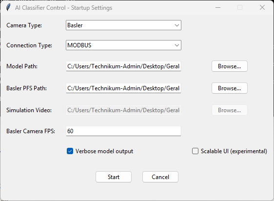
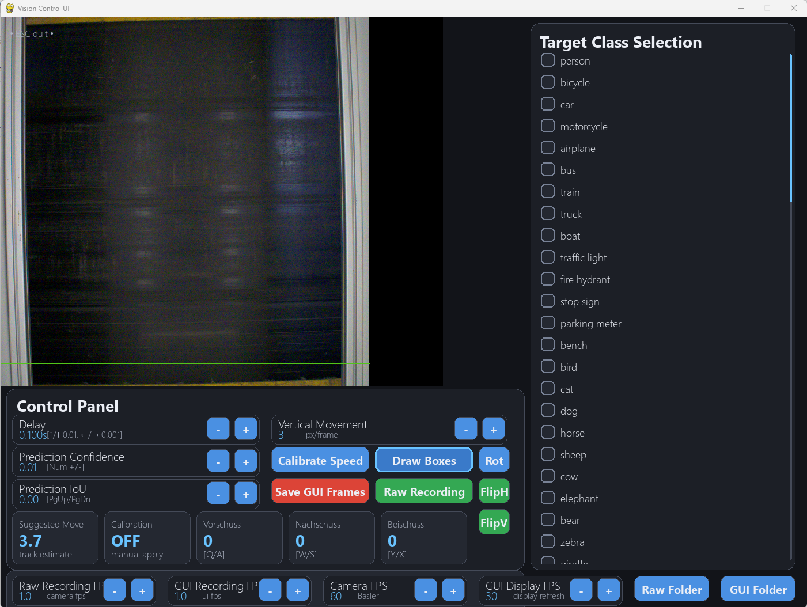

# SenSoRTC

**Sensor Based Sorting Real Time Control Software**  
**Version 1.1.1**

SenSoRTC is a modular, multiprocessing platform for real-time camera-based classification and sorting. It combines RGB object detection or near-infrared (NIR) line-scan classification with configurable pneumatic nozzle activation. It is intended for conveyor-based inspection and material separation, including recycling, agriculture, food inspection, and industrial quality control.

## Features

| Area | Capabilities |
| --- | --- |
| Camera inputs | Basler industrial cameras (Pylon), USB cameras (OpenCV), simulated video, mvIMPACT NIR line-scan cameras |
| RGB inference | Ultralytics YOLO detection, configurable confidence/IoU, bounding boxes, target-class selection |
| NIR inference | Spectral classification, rolling line visualization, background thresholding, class-based ejection |
| Outputs | UDP (Binder HPNB), MODBUS (EVK HPNB), Arduino serial, simulated nozzle visualization |
| Runtime controls | Ejection delay, mask expansion, vertical movement, image orientation, recording, target classes |
| Belt mapping (1.1.1) | Independently configurable left/right inactive nozzle margins for UDP and MODBUS, adjustable live |
| Recording | Camera images, GUI frames, timestamped NIR spectral chunks |
| Architecture | Separate acquisition/inference, consumer/nozzle-control, and display processes; queue-based communication |

## Architecture

```text
                      ┌───────────────────────────────┐
                      │ Camera / simulated video      │
                      └──────────────┬────────────────┘
                                     │
                                     ▼
                      ┌───────────────────────────────┐
                      │ Producer process              │
                      │ RGB: YOLO inference           │
                      │ NIR: spectral classification  │
                      │ Detection / nozzle-mask build │
                      └──────────────┬────────────────┘
                                     │
                      ┌──────────────┴──────────────┐
                      ▼                             ▼
                Display queue                 Activation queue
                      │                             │
                      ▼                             ▼
                pygame control UI             Consumer / timing
                + live parameters             + nozzle controller
                                                    │
                                                    ▼
                                        UDP / MODBUS / serial
                                        or simulated outputs
```

The RGB path performs image acquisition, detection or tracking, bounding-box filtering, mask generation, temporal accumulation, and motion/delay compensation. The NIR path classifies acquired spectral lines and generates class-based activation masks. The selected nozzle backend receives the resulting activation data.

## Startup and user interface

Start the application with:

```bash
python SenSoRTC.py
```

The startup interface allows selection of the camera, detection model or NIR classifier, output interface, simulated input, and relevant settings.



The main pygame interface displays the live classification view and nozzle activation mask. Depending on the selected mode, it provides class selection, confidence and IoU thresholds, NIR background threshold, timing adjustments, vertical movement calibration, camera rotation/flipping, and recording controls.



### Keyboard shortcuts

| Key | Action |
| --- | --- |
| `Esc` twice within 1.5 s | Quit |
| `F1` / `H` | Show or hide keyboard help |
| `Space` | Toggle GUI frame recording |
| `0` | Toggle all target classes |
| `1` / `2` | Toggle first / second target class |
| `↑` / `↓` | Increase / decrease delay by 0.01 s |
| `←` / `→` | Increase / decrease delay by 0.001 s |
| Numpad `+` / `-` | Adjust RGB confidence |
| `Page Up` / `Page Down` | Adjust RGB IoU |
| `Q` / `A` | Increase / decrease *Vorschuss* |
| `W` / `S` | Increase / decrease *Nachschuss* |
| `X` / `Y` | Increase / decrease *Beischuss* |
| `V` / `B` | Increase / decrease vertical movement |
| `P` / `O` | Adjust NIR background threshold in NIR mode |

*Vorschuss* expands the activation mask forward, *Nachschuss* expands it rearward, and *Beischuss* expands it laterally. The relevance of individual controls depends on the active camera mode.

## Camera modes

- **Basler:** Industrial area-scan acquisition using the Basler Pylon SDK and `pypylon`.
- **USB:** Standard camera acquisition through OpenCV; Linux devices may expose additional V4L2 controls.
- **Simulated:** Video-file input for offline testing; the original simulation workflow loops the input and resizes it for processing.
- **mvIMPACT NIR:** Line-scan spectral acquisition, rolling visualization, background elimination, and spectral classification. The camera SDK and an appropriate classifier/configuration are required for the intended hardware setup.

## Nozzle control and belt-width calibration

| Backend | Intended use |
| --- | --- |
| UDP | Binder HPNB, 128-nozzle configuration |
| MODBUS | EVK HPNB, 80-nozzle configuration |
| Arduino serial | Serial-controlled flipper/nozzle outputs |
| Simulated | Visual output simulation, including a 10-nozzle display |

**New in 1.1.1:** UDP and MODBUS support proportional mapping of the full camera detection width onto a smaller physical nozzle span. Configure the number of nozzles outside the conveyor on each side:

```yaml
UDP_LEFT_UNUSED_NOZZLES: 0
UDP_RIGHT_UNUSED_NOZZLES: 0
MODBUS_LEFT_UNUSED_NOZZLES: 0
MODBUS_RIGHT_UNUSED_NOZZLES: 0
```

These values are initialized from `runtime_settings.yaml`, passed to the GUI and nozzle-control process through shared memory, and can be changed live with **Left off** and **Right off**. The two controller configurations are independent. At least one nozzle must remain usable.

The UDP wiring permutation is applied **after** the proportional logical mapping. MODBUS retains its hardware-specific inverted coil logic. Setting both margins to zero preserves the previous mapping. The Arduino serial backend is unaffected.

**Hardware safety:** Confirm camera-to-nozzle orientation and physical numbering before enabling live ejection. Startup test shots are separate from the camera-based belt-width mapping and may activate a nozzle outside the configured belt span.

## Installation

### General prerequisites

- A supported Python environment and the packages required by the selected camera, model, and nozzle backend.
- For Basler cameras: [Basler Pylon Software Suite](https://www.baslerweb.com/de-de/downloads/software/143940061/).
- For mvIMPACT NIR cameras: the corresponding mvIMPACT SDK, camera drivers, and device configuration.
- For NVIDIA Jetson: use a PyTorch build compatible with the installed JetPack, CUDA, architecture, and Python versions. **Do not assume a default PyPI PyTorch wheel is suitable for ARM64.**

The installation commands below are carried over from the existing project instructions. Package and wheel compatibility should be checked against the target system before deployment.

### NVIDIA Jetson Thor — JetPack 7

#### Option A: Prebuilt Conda environment

The original setup guide refers to an environment definition named `SenSoRTC_THOR.yml`:

```bash
conda env create -f SenSoRTC_THOR.yml
conda activate SenSoRTC
```

**Note:** The referenced environment YAML is not included in the supplied stripped 1.1.1 archive; provide it separately if this installation route is offered in the repository.

#### Option B: Native installation

```bash
conda create -n SenSoRTC python=3.12 spyder
conda activate SenSoRTC

sudo apt update
sudo apt install python3-pip -y
pip install -U pip
pip install 'ultralytics[export]'
```

The original Thor instructions specify a CUDA 13.0 PyTorch index:

```bash
pip install torch torchvision --index-url https://download.pytorch.org/whl/cu130
```

For export-related ONNX Runtime functionality, the original guide specifies:

```bash
pip install https://github.com/ultralytics/assets/releases/download/v0.0.0/onnxruntime_gpu-1.24.0-cp312-cp312-linux_aarch64.whl
```

Additional packages:

```bash
pip install pygame-ce==2.5.6 pymodbus==3.5.4 pypylon==26.3.1
pip install pyserial==3.5 easygui==0.98.3 lap==0.5.13
```

The original installation sequence recommends a reboot after the initial Ultralytics installation:

```bash
sudo reboot
```

### NVIDIA Jetson Orin / Nano — JetPack 6

```bash
conda create -n SenSoRTC python=3.10 spyder
conda activate SenSoRTC

sudo apt update
sudo apt install python3-pip -y
pip install -U pip
pip install 'ultralytics[export]'
```

The original Orin/Nano guide specifies these ARM64 wheel URLs:

```bash
pip install https://github.com/ultralytics/assets/releases/download/v0.0.0/torch-2.10.0-cp310-cp310-linux_aarch64.whl
pip install https://github.com/ultralytics/assets/releases/download/v0.0.0/torchvision-0.25.0-cp310-cp310-linux_aarch64.whl
```

It also includes cuDSS installation:

```bash
wget https://developer.download.nvidia.com/compute/cudss/0.7.1/local_installers/cudss-local-tegra-repo-ubuntu2204-0.7.1_0.7.1-1_arm64.deb
sudo dpkg -i cudss-local-tegra-repo-ubuntu2204-0.7.1_0.7.1-1_arm64.deb
sudo cp /var/cudss-local-tegra-repo-ubuntu2204-0.7.1/cudss-*-keyring.gpg /usr/share/keyrings/
sudo apt-get update
sudo apt-get -y install cudss
```

ONNX Runtime and additional packages from the original guide:

```bash
pip install https://github.com/ultralytics/assets/releases/download/v0.0.0/onnxruntime_gpu-1.23.0-cp310-cp310-linux_aarch64.whl
pip install pygame-ce==2.5.6 pymodbus==3.5.4 pypylon==26.3.1
pip install pyserial==3.5 easygui==0.98.3 lap==0.5.13
```

Reboot if required after installing system-level dependencies.

### Other Python environments

The original general-purpose guide lists the following core packages:

```bash
pip install ultralytics opencv-python numpy pyyaml pypylon
```

Additional packages are needed for the pygame GUI, tracking, NIR classification, and selected hardware interfaces. The Jetson instructions above give project-specific package versions for several of these dependencies.

## Configuration and recording

| File or directory | Purpose |
| --- | --- |
| `SenSoRTC.py` | Main application and process orchestration |
| `STARTUP_SETTINGS_GUI.py` | Startup configuration interface |
| `UI_LAYER.py` | Live pygame interface |
| `NOZZLE_CONTROL_LAYER.py` | Hardware and simulated nozzle backends |
| `mvimpact_nir_camera.py` | mvIMPACT NIR camera adapter |
| `mvimpact_nir_camera_settings.yaml` | NIR camera acquisition settings |
| `SKLEARN_PIPELINES.py` | sklearn-related classification support |
| `runtime_settings.yaml` | Persisted runtime parameters and UDP/MODBUS belt margins |
| `Recordings_Camera/` | Raw camera recording output |
| `Recordings_GUI/` | GUI frame recording output |

The application also uses startup configuration and hardware-specific settings. NIR spectral recordings are written in timestamped chunks. Large model files, such as TensorRT `.engine` files, and trained NIR classifiers may be distributed separately from a source-only archive.

## USB camera controls on Linux / Jetson

Install Video4Linux utilities:

```bash
sudo apt update
sudo apt install v4l-utils -y
```

Select the USB camera in the startup GUI and open the USB camera configurator, or inspect the device directly:

```bash
v4l2-ctl -d /dev/video0 --list-ctrls
```

If the camera exposes `focus_auto` and `focus_absolute`, autofocus can be disabled and manual focus adjusted:

```bash
v4l2-ctl -d /dev/video0 -c focus_auto=0
v4l2-ctl -d /dev/video0 -c focus_absolute=30
```

Values are camera-dependent. You can also adjust supported controls while the application is running:

```bash
v4l2-ctl -d /dev/video0 -c focus_absolute=350
```

If a control does not appear in `--list-ctrls`, the camera may have fixed focus or may not expose that control through V4L2.

## Troubleshooting and development notes

- **Start with simulation:** Use a simulated camera and simulated nozzles to check the processing pipeline without energizing physical outputs.
- **Multiprocessing:** The project uses separate processes; explicitly pass shared state and process arguments rather than relying on ordinary globals.
- **Simulated video:** Ensure the video path is passed through the camera initialization path; preserve the intended aspect ratio during preprocessing.
- **Detection:** Enable bounding boxes and inspect activation-mask slices when checking alignment or mask expansion.
- **Vertical calibration:** Compare tracking-based estimates with the configured movement before enabling sorting.
- **NIR acquisition:** Verify camera SDK/driver availability, acquisition stability, and classifier compatibility with the configured spectral dimensions.

### Arduino CH341 serial driver on Linux / Jetson

The original project notes identify CH341 driver availability as a possible issue. If a locally built driver is required, the documented diagnostic workflow is:

```bash
cd ~/ch341ser_linux/driver
sudo insmod ./ch341.ko
lsmod | grep ch34
dmesg | tail -20
ls /dev/ttyCH341* /dev/ttyUSB* /dev/ttyACM* 2>/dev/null
```

Only load a kernel module built for the running kernel, and check whether the distribution's existing driver already supports the device.

## Extending SenSoRTC

New nozzle backends can follow the existing queue/stop-flag interface:

```python
def nozzle_control_MY_BACKEND(queue, stop_flag):
    # Translate activation masks to backend-specific commands.
    pass
```

New camera integrations should be connected through the existing camera-selection and acquisition paths, rather than bypassing process orchestration.

## License

A license has not been specified in the supplied project documentation. Add a `LICENSE` file and update this section when the intended licensing terms are established.
